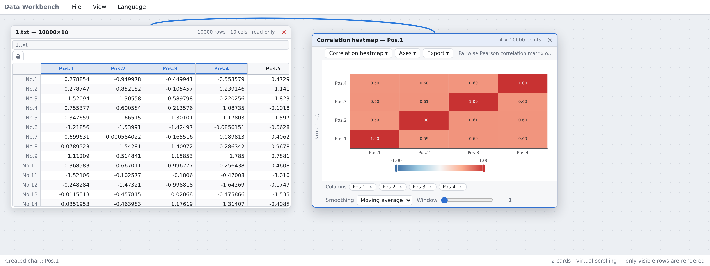
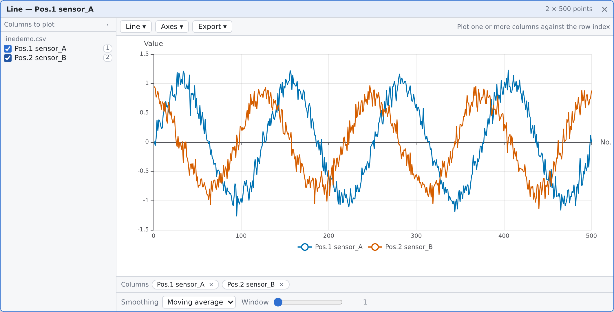
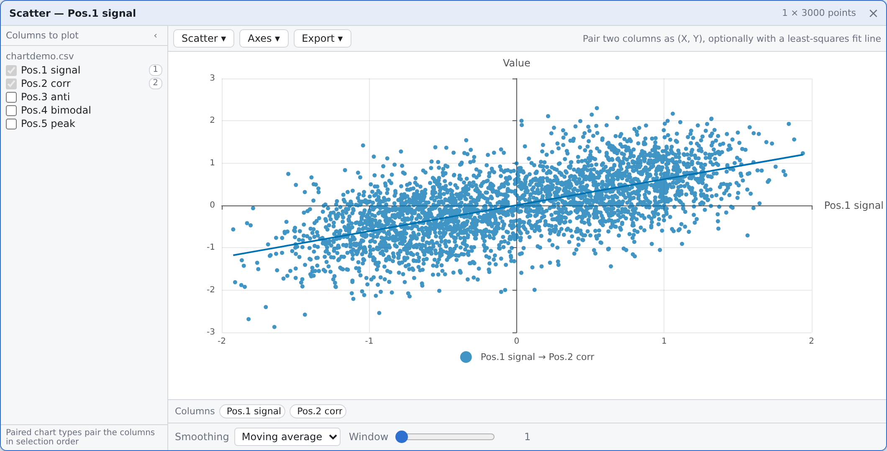
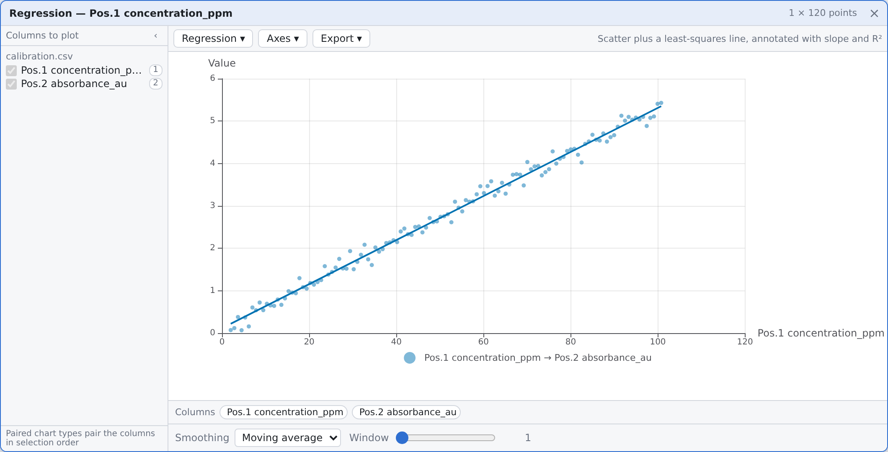
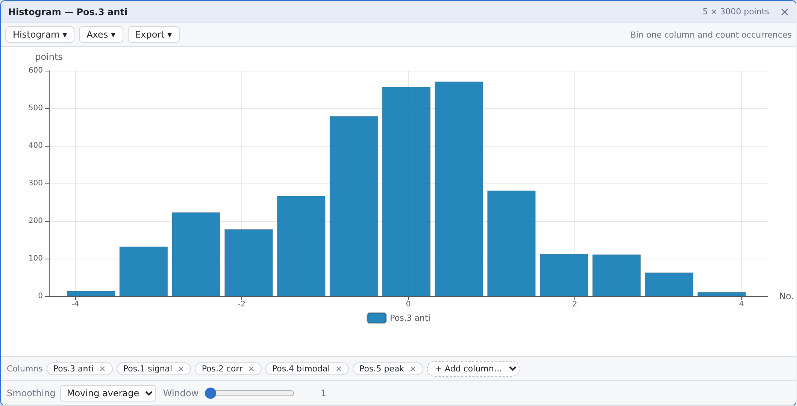
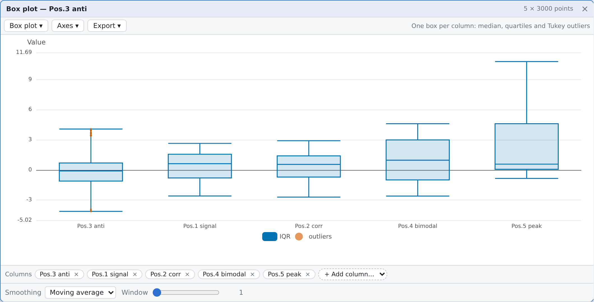
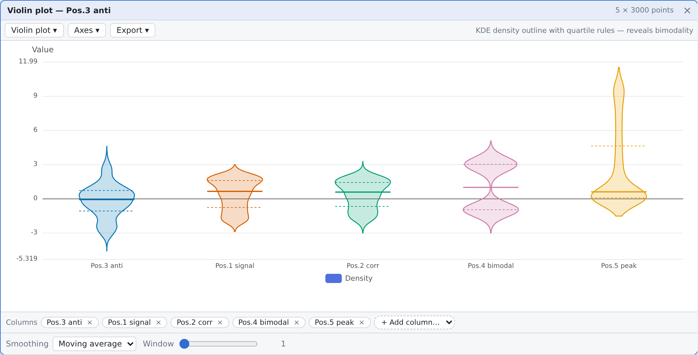
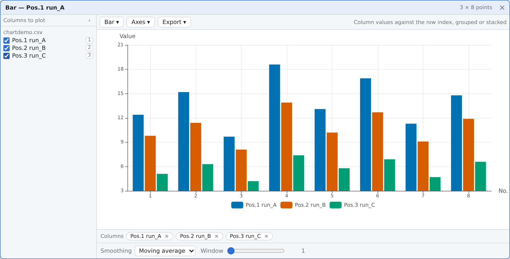
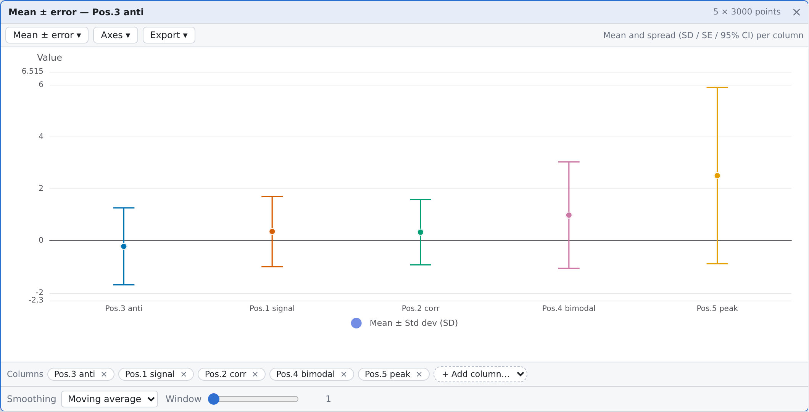
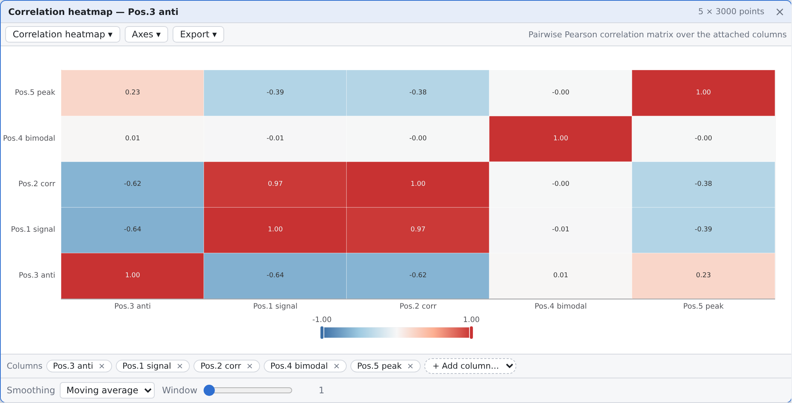

# Data Workbench — Data Matrix Workbench

[](https://github.com/teglaven/DataCardForge/actions/workflows/ci.yml)
[-2ea44f)](https://teglaven.github.io/DataCardForge/)
[](LICENSE)
[](web/tests)

**[English](README.md) | [中文](README.zh-CN.md)**

A lightweight **data matrix batch-processing workbench** for industrial / scientific scenarios.

> ⚠️ **Early Experimental Project**: As of October 2026, this project is still in its **early experimental stage**. You can use it to try out features and test workflows, but it is **strongly not recommended** for production use or formal scientific research.

<p align="center">
  
</p>

**Author & provenance**: `teglaven` · GPL-3.0 · see [`PROVENANCE.md`](PROVENANCE.md) for the
verifiable author identity, timeline and commit anchors.
**Verified state** (last verified 2026-10-28): 489 frontend unit tests · 7 backend ctest cases
(3 opt-in) · end-to-end smoke checks — all green.
**Not finished yet**: function cards are a work in progress; per-port connections were repaired on
2026-10-28 and hover/edge-editing are still missing — both are spelled out under
[Status & known gaps](#status--known-gaps).

## Try it

**In the browser, no install** — <https://teglaven.github.io/DataCardForge/> runs the React front end as a
static site. Drag [`docs/sampleData/1.txt`](docs/sampleData/1.txt) onto the canvas, then right-click a column
header → *Draw chart*. File loading and all nine chart types work there; the C++ compute service does not,
so function cards show the "backend unreachable" banner — that is the designed visible degradation, not a bug.

**Locally, with the compute backend** — one command builds the C++ service and starts both servers:

```bash
./scripts/dev.sh          # backend on :37811, Vite on :5173
```

Requirements: Node 22+, CMake 3.24+, a C++17 compiler and the Eigen 3.4 headers
(`sudo apt install build-essential cmake ninja-build libeigen3-dev`).

## Design Philosophy

- **Card model**: everything is a card — data card (file) → function card (transform) → output card (plot / export)
- **Strict separation**: data and behavior are separated; tables are never mutated; every transformation produces a new card
- **Connection subordination**: connections are only the visualization of data dependencies, normally kept low-key (background layer), and never interfere with card layout or interaction — cards are the protagonists, connections the supporting cast
- **Backend-owns-compute (B-plan)**: all numeric / statistical / matrix computation runs in the **C++/Eigen backend**; the browser is a **pure interaction surface** (rendering, input, layout). The backend being unreachable is a **visible state with a retry button**, never silent. This supersedes the earlier T1-browser-baseline tier table while preserving the three contracts of the [maximum-headroom principle](docs/docs/decisions/2026-10-15-max-headroom-principle.md): visible degradation, cross-tier semantic consistency (differential fixtures), bounded worst-case. Full reasoning: [decision record](docs/docs/decisions/2026-10-17-backend-owns-compute.md)
- **Column-oriented matrix**: rows = samples (`No.N`), columns = variables (`Pos.N`), contiguous storage, high performance
- **Extensible**: computation system + adapter interfaces — the community can contribute long-tail features

## Architecture

```
┌─────────────────────────────────────────────────────┐
│                   Browser (Web)                     │
│  React 19 · ECharts 6 · zustand · VirtualTable      │
│  Card layout · Ports · Connections · Status lamps   │
│  Pure interaction — NO numeric computation          │
└──────────────────────┬──────────────────────────────┘
                       │ HTTP + JSON + DCM2 binary
                       ▼
┌─────────────────────────────────────────────────────┐
│              Compute Backend (C++17)                │
│  Eigen 3.4 · Expression engine · Dependency graph   │
│  Matrix store · Node scheduler · Event bus          │
│  All numeric / statistical / matrix computation     │
└─────────────────────────────────────────────────────┘
```

The frontend speaks [protocol v1](docs/docs/architecture/backend-protocol-v1.md): JSON control messages over HTTP plus DCM2 binary frames for dense-matrix windows (window + full shape). Long-poll event stream pushes node state changes (dirty → computing → done | error) to drive the four-state status lamps.

## Implemented Features

### File Loading
- **File → Open Data Files**, **right-click the empty area**, or **drop files onto the canvas**
- Multiple files create only **one card**; a selector at the top of the card switches the displayed file
- Supports TXT / CSV / TSV / DAT / XLSX; CSV parsing handles quoted fields and sniffs the delimiter
- **Automatic header detection**: if the first row is not purely numeric it is treated as column titles (annotations) rather than data
- File-backed tables start **read-only**; the lock button in the card's file row unlocks editing. Unparseable cells show `—` instead of being silently turned into 0, and a value that is not a number is refused with an explanation rather than dropped
- Parsing runs in a **Web Worker**, so dropping a 10 000-row file no longer freezes the interface (falls back inline where workers are unavailable)
- Re-opening the same file reuses its parse only when the **bytes match** (`size` + `lastModified`); a different file that merely shares the name gets a fresh parse — never stale measurements under a current label
- Loaded matrices are **automatically registered with the compute backend** (fire-and-forget; UI never blocks on network)

### Plotting (ChartCard)
- Right-click a column header → **pick the chart type directly** (types that would run past the last column are disabled, with the reason in the tooltip)
- **9 scientific/statistical chart types**, all rendered as SVG and therefore **all exportable as true vector**:
  - Line, scatter, **regression** (OLS with slope, **R²** and n)
  - Bar (grouped/stacked), **histogram** (Sturges auto-binning or explicit)
  - **Box plot** (median/quartiles/whiskers + **Tukey outliers**)
  - **Violin plot** (KDE density outline + quartile rules — reveals **bimodality**)
  - **Mean ± error bars** (**SD / SE / 95% CI**, adjustable cap width)
  - **Correlation heatmap** (pairwise **Pearson** matrix, diverging palette)
- The type can be switched at any time inside the card; one chart can hold **several columns** (scatter/regression pair them as (X, Y))
- Log Y axis / second axis / fit line / X-axis source / reset-zoom appear only where the type supports them
- **Smoothing controls** at the bottom: moving average / exponential / median / Savitzky–Golay, redrawing live and keeping their settings when the data source changes
- **Export**: **SVG (true vector — the live DOM tree serialised, no embedded bitmap)** / PNG (1×/2×/4×) / PDF (raster wrapper, explicitly labelled as non-vector in the UI)
- All dependent charts update automatically when the file switches; old data is kept when a column no longer exists
- Zoom / pan (both axes, wheel or drag) with a **Reset zoom** control in the axes panel; legend keeps fit-line names out of it

> The statistics live in `core/stats.ts` as pure functions with 40 unit tests, matching
> NumPy/R conventions (linear-interpolation quantiles, Bessel-corrected variance, Silverman
> bandwidth, t-distribution confidence intervals, Tukey outliers).

### Compute Backend (C++/Eigen)

The backend holds **authoritative copies** of all data, dependency graphs, and compute definitions. The browser keeps only revision-keyed read-only display caches.

- **Expression engine**: full semantic port of the TS reference (`expression.ts`) — 81 expression fixtures + 14 matrix fixtures + randomized differential fuzz guarantee identical results. Supports arithmetic, comparisons, aggregations (SUM/AVG/MIN/MAX/MEDIAN/STD with NaN skipping and Bessel-corrected STD), element-wise math (ABS/SQRT/LOG/LN/LOG10/EXP/POW/ROUND/FLOOR/CEIL/SIGN), moving window (MOV/EMA), conditionals (IF)
  - **Column references** (2026-10-28): `Pos.1` / `pos.1` (case-insensitive), bare annotations
    (`时间_秒`), bracket-quoted verbatim names (`[地面速度_μm/s]` — the only spelling when a name
    contains `/`, a space or parentheses), and port qualification for multi-input cards
    (`A.pos.1`, `src.时间_秒`, `A.[…]`). Full-width punctuation (`（）`, `，`, `×`, `／`, `－`) is
    accepted as its ASCII equivalent. See [the decision record](docs/docs/decisions/2026-10-28-expression-reference-syntax.md)
- **Matrix-mode evaluation**: when any input variable is declared matrix-mode, `*` becomes matrix multiplication; additional functions: `TRANSPOSE`, `DET`, `INV`, `SOLVE`, `MMUL` (explicit matmul), `EMUL` (explicit element-wise multiply). Shape mismatches produce structured `shapeMismatch` errors — never silent garbage
- **Dependency graph**: per-port edges, atomic cycle refusal (N edges either all register or none), result-matrix-aware cascade via `resultOwner_` map
- **Node state machine**: dirty → computing → done | error, pushed via monotonic-seq event stream
- **Protocol v1**: HTTP/1.1 + JSON control plane + DCM2 binary matrix frames (window + full shape) + long-poll events. Version handshake on connect; mismatch → visible banner

> Cross-tier test fixtures (`web/tests/fixtures/xlayer/`) are the single judge format.
> Both the TS reference and C++ engine must pass the same JSON — CI enforces this.

### Connection Visualization (ConnectionLayer)
- **One line per dependency edge**: table → function card, function card → function card, and table/function → chart (after schema v2 a function card is a graph node too)
- **Endpoints are the two card-window centres** (2026-10-29); the mask swallows the part inside each card, so the visible wire starts and ends at the frames
- The whole route is **one cubic Bézier** (at most two inflection points); its control points blend between the horizontal and the vertical solution by `|dx|/(|dx|+|dy|)`, so dragging across the diagonal cannot flip the curve
- Red = source card selected (long dashes), blue = target card selected (short dashes), gray = neither (thin solid); the red/blue wires **flow toward the target**, so colour + flow direction + dash pattern all encode input vs output (colour-blind friendly)
- The arrowhead parks **outside the target card's frame** (inside it the mask would erase it); when the target card covers the whole wire no arrow is drawn at all
- Selecting a card labels its lines at the middle of the **visible** stretch with the `portId`s they carry (multi-port edges fold into `+N`)
- Lines track in real time when cards move or resize (driven by a layout version counter, not a polling timer); **table scrolling no longer moves them**
- A layout jump (tile / cascade / project load / undo) tweens the curve over 220 ms; when the transition would sweep across a third card, it is shortened to 70 ms so the wire crosses that window quickly
- The layer is `pointer-events: none`, so it never steals input or affects layout (the **connection subordination** principle holds by construction)
- Stroke width, dash length and flow cycle are divided by the zoom in the component, so they stay constant **on screen** across the 10%–300% range

### UI / Interaction
- Consistent theme with automatic light/dark adaptation
- **Unbounded canvas + whole-workbench zoom**: the card plane grows with the workflow instead of
  ending at the window edge
  - **Wheel = zoom everything** (cards, table text, charts, connections scale together, anchored on
    the cursor, 10%–300%); over a card the wheel still belongs to the card (table scrolling, chart
    zoom), while **Ctrl/Cmd+wheel zooms there too** — and so does a trackpad pinch
  - **Pan**: middle-drag, **space+left drag**, or a left drag on the bare canvas
  - **View → Reset View** fits the whole workflow (auto zoom + centre); **Tile/Cascade** lay out
    inside the visible area — see the [decision](docs/docs/decisions/2026-10-21-infinite-canvas.md)
- Cards drag, resize and stack freely, plus **Tile / Cascade / Close All**
- A table that still feeds a chart **refuses to close**, and its connections blink to explain why
- Runtime **Chinese/English switching**, **workspace persistence** (layout + dependencies + data), and CSV export of the current table
- **Backend availability banner**: when the compute backend is unreachable or version-mismatched, a visible alert bar appears with a retry button — never a blank screen

## Screenshots

Every image below is real headless-Chromium output of the production build, not a mock-up
(more in [`web/docs/screenshots/`](web/docs/screenshots/), regenerated by `web/scripts/smoke.mjs`).

| | | |
|---|---|---|
|  |  |  |
| **Line** — one or more columns against the row index; zoom, log Y, smoothing | **Scatter** — two columns paired as (X, Y), optional least-squares line | **Regression** — scatter + OLS fit, annotated with slope and R² |
|  |  |  |
| **Histogram** — Sturges auto-binning or explicit bin count | **Box plot** — median / quartiles / whiskers / Tukey outliers | **Violin** — KDE outline + quartile rules; bimodality is visible |
|  |  |  |
| **Bar** — grouped or stacked, against the row index | **Mean ± error** — mean with SD / SE / 95 % CI per column | **Correlation heatmap** — pairwise Pearson matrix |

## Scope & Limitations

- Internal data is stored as **IEEE 754 double** (~15–17 significant digits), consistent with Excel's native numeric model
- Suitable for batch processing and visualization of **floating-point numeric** data (sensors, measurements, experiments)
- > ⚠️ **Not suitable** for scenarios requiring exact decimal arithmetic (e.g., financial / accounting amounts) or arbitrary-precision computation — Excel and most similar tools cannot satisfy these either
- The compute backend is a **required dependency** — without it, file loading and chart rendering still work locally, but formula evaluation and matrix operations are unavailable (with a visible banner)

## Status & known gaps

This repository is intentionally honest about what is finished: the table/chart path is complete and
gated by tests, while the card-graph layer is still being closed out.

| Area | State |
|---|---|
| Data cards, virtualised table, 9 chart types, exports, i18n, workspace persistence | **Done**, covered by unit + end-to-end gates |
| Compute backend (expression engine, matrix operators, dependency graph, scheduling) | **Done** for the two shipped signatures (`builtin:expr`, `builtin:linear-regression`) |
| **Function cards** | **Half-finished (WIP)** — see below |
| **Port-level connections** | **Repaired 2026-10-28**, geometry re-cut 2026-10-29 (port ids on edges; endpoints are the card centres; flowing dashes; arrows on the target frame) — see below |

### Function cards are still a work in progress

What already works: creating a function card from a column or from the toolbar, editing expressions
(one row per output), the three-pane layout (input ports / formula editor / result grid), chaining a
function card into the next one, plotting a function card's output, single-column port binding
(`mode: "cell"`) and the column-count contract with its violation escape hatches.

**Closed on 2026-10-28**: how a column may be referenced (an annotated file used to have *no*
addressable column name at all — even the documented `Pos.N` fallback was broken) and where the
reference lives in the UI (Help menu / `?` on the card / a 1 s hover tooltip at the pointer /
clickable column chips). A layout collapse that hid the formula row as soon as a card produced
numbers was fixed at the same time. See the [log](docs/docs/log/2026-10-28.md) and the
[syntax decision](docs/docs/decisions/2026-10-28-expression-reference-syntax.md).

A file switch still never re-points a function card silently (schema v2), so the card shows a
**pending** offer instead — and that offer is now a flashing yellow gradient box. It used to be a
pale accent-coloured panel and users read it as decoration rather than as "answer me". Only the
gradient position and the outer glow animate (the text never blinks), and
`prefers-reduced-motion` keeps the yellow and the ring while dropping the motion.

What is still missing, and why it is not "done":

- **Per-signature parameter forms** — the parameter zone renders `params.formulas` only. A signature
  whose parameters are not a formula list (e.g. confidence level, window size) has no form yet; the
  card states its inputs in words instead of rendering controls.
- **Output selector (K > 1)** — the card model carries one display cache, so a signature with several
  outputs can only show output 0's table.
- Interaction polish (layout, spacing, states) around the three panes.

The data model and the contracts are settled (see
[`docs/docs/decisions/2026-10-27-card-contracts.md`](docs/docs/decisions/2026-10-27-card-contracts.md),
[`2026-10-26-card-schema-v2.md`](docs/docs/decisions/2026-10-26-card-schema-v2.md)); what is missing is
UI on top of it. Treat the function card as **API-stable, UX-incomplete**.

### Port-level connections (repaired 2026-10-28, geometry revised 2026-10-29)

Schema v2 moved dependencies into the envelope and bindings onto ports, and the connection layer fell
back to card-level: neither geometry nor interaction could see a `portId`. Dependency edges now
**carry their port ids**, function cards register their input ports and output rows as anchors, and
selecting a card labels its lines with the port identity.

2026-10-29 revised the **geometry**: endpoints no longer sit on a port but on the two card-window
centres (the mask swallows the inside of each card), the route is a single cubic Bézier, red/blue are
long/short flowing dashes, and the arrowhead parks outside the target frame. Ports are back to what
they were — data identity and the label's source. See the
[centre-endpoint decision](docs/docs/decisions/2026-10-29-connection-center-anchors.md).

Still missing: hover/selection of a single line, deleting a line (disconnecting means editing data and
wants an undo path — tracked separately), dragging a new line, and port dots (`portAnchor` is reserved
for those). See the
[decision record](docs/docs/decisions/2026-10-28-port-level-connections.md).

## Tech Stack

| Component | Purpose | Notes |
|-----------|---------|-------|
| React 19 + Vite 8 | UI framework and build | TypeScript 7 `strict` |
| ECharts 6 | Charts | **SVG renderer**, vector export |
| react-rnd | Card drag / resize | |
| zustand | State (card table + dependency graph) | |
| @e965/xlsx | Excel read | Loaded on demand |
| Hand-rolled virtual scrolling | Large-table rendering | No third-party dependency |
| Web Worker (`src/loaders/parse.worker.ts`) | Off-thread file parsing | Keeps the UI responsive on large files |
| **C++17 / g++ 15** | Compute backend language | CMake 4 + Ninja |
| **Eigen 3.4** | Linear algebra / matrix operations | Header-only, `/usr/include/eigen3` |
| POSIX sockets | Backend HTTP server | Zero third-party networking deps |

## Building & Running

### Prerequisites

**Frontend** (Node.js 22+):
```bash
cd web && npm install
```

**Backend** (Ubuntu / Debian):
```bash
sudo apt-get install build-essential cmake ninja-build libeigen3-dev
```

> On other platforms: any C++17 compiler + CMake 3.24+ + Eigen 3.4 headers will work.
> The toolchain is verified on Ubuntu 26.04 with g++ 15.2, cmake 4.2, ninja 1.13.

### One-command dev

```bash
./scripts/dev.sh          # builds backend + starts both servers
```

This runs `cmake --build backend/build`, starts `dc_backend` on port 37811, and launches `vite dev` with `/api` proxied to the backend. Ctrl-C kills both.

### Manual steps

```bash
# Backend
cmake -S backend -B backend/build -G Ninja
cmake --build backend/build
./backend/build/dc_backend --port 37811

# Frontend (in another terminal)
cd web
npm run dev               # dev server at http://localhost:5173
npm run build             # type check + production build → web/dist/
npm test                  # unit tests (vitest, includes cross-tier fixtures)
```

### Tests

```bash
# Frontend: typecheck + unit tests (count printed by vitest; includes 81 cross-tier differential fixtures)
cd web && npm run typecheck && npm test

# Backend: 7 ctest cases (cross-tier fixtures, matrix operators, node registry, card fixtures; 3 further gates are opt-in and Skipped by default)
cd backend && ctest --test-dir build --output-on-failure

# Opt-in gates: differential fuzz (random TS↔C++ cross-check) and HTTP malformed-request stress
DC_RUN_FUZZ=1 ctest --test-dir build -R diff_fuzz --output-on-failure
DC_RUN_STRESS=1 ctest --test-dir build -R http_stress --output-on-failure

# End-to-end smoke (run `npm run preview` first)
node web/scripts/smoke.mjs http://127.0.0.1:4173
```

### CI

GitHub Actions runs three jobs on every push/PR:
1. **typecheck-and-test**: `npm ci` → typecheck → vitest → production build
2. **backend-test**: `apt install toolchain` → cmake build → ctest (cross-tier fixtures + node registry)
3. **e2e-smoke**: Playwright Chromium against `vite preview`

A fourth workflow, [`.github/workflows/pages.yml`](.github/workflows/pages.yml), publishes the front end to
GitHub Pages on every push that touches `web/` — that is what serves the live demo above.

## Architecture Extension Points

- `backend/src/expression.cpp` → expression engine (cell-mode + matrix-mode evaluators)
- `backend/src/matrix_value.h` → MatVal type wrapping Eigen::MatrixXd with shape enforcement
- `backend/src/nodes.cpp` → compute node registry, dependency graph, scheduler
- `backend/src/http_server.cpp` → protocol v1 HTTP endpoints
- `web/src/backend/client.ts` → frontend transport client (protocol v1)
- `web/src/loaders/` → adapters for new file formats (`FileLoader`)
- `web/src/core/MatrixData.ts` → client-side data model (display cache under B-plan)
- `web/src/ui/ConnectionLayer.tsx` → connection visualization
- `web/tests/fixtures/xlayer/` → cross-tier differential test fixtures (single judge format)

## Short-term Goals

- [x] **Frontend decision** → **Web chosen** (2026-10-14)
- [x] **Qt UI implementation removed** → repo is now web-first (2026-10-15)
- [x] **Dependency cycle detection** → `DependencyGraph` refuses loops and deduplicates edges (2026-10-15)
- [x] **Maximum-headroom principle adopted** → visible degradation contract (2026-10-15)
- [x] **B-plan decided** → backend owns compute, browser is pure interaction (2026-10-17)
- [x] **Cross-tier differential fixtures** → 81 expression cases, single JSON judge format (2026-10-17; extended 2026-10-21 and 2026-10-28)
- [x] **Differential fuzz gate** → random TS↔C++ cross-check incl. error codes/positions, reproducible seeds (2026-10-21)
- [x] **C++/Eigen compute backend skeleton** → expression engine port, node registry, HTTP API, protocol v1 (2026-10-17)
- [x] **Frontend transport client** → backend handshake, matrix registration, event polling, visible offline banner (2026-10-17)
- [x] **One-command dev + CI gate** → `scripts/dev.sh`, vite proxy, GitHub Actions backend-test job (2026-10-17)
- [x] **Eigen matrix operators** → matmul, transpose, det, inv, solve + matrix-mode expression evaluator + 14 matrix fixtures (2026-10-17)
- [ ] **Function card UI** — *partial*: the three-pane skeleton (input ports / formula editor / result grid),
  expression + linear-regression signatures, card chaining and "result can be plotted" all work; still
  missing per-signature parameter forms, an output selector for K > 1 signatures, and interaction polish
- [x] **Unbounded canvas (pan)** → plane grows with the cards, four pan gestures, View → Reset View (2026-10-21)
- [x] **Whole-workbench zoom** → wheel zoom anchored on the cursor, 10%–300%, cards/fonts/charts/connections scale together (2026-10-21)
- [ ] **Canvas minimap / zoom shortcuts**: overview and keyboard zoom (the entry point is clear: reuse resetView's fit maths)
- [ ] **VirtualTable windowed data source**: large matrices fetched by visible-row window, not loaded whole
- [x] **Port anchors**: per-port connection endpoints in `cardMetrics` + `ConnectionLayer` (2026-10-28);
  since 2026-10-29 ports are data identity only — the geometry endpoints are the card centres
- [x] **Per-port logical-connection hints** (repaired 2026-10-28 — see [Status & known gaps](#status--known-gaps))
- [x] **Four-state status lamps** (2026-10-27): driven by node state events (gray/yellow/green/red)
- [ ] Data **editing** capability (non-file-backed cards, double-click edit + formula evaluation)
- [x] Connection arrows pointing at the target (2026-10-28), parked outside the target frame since 2026-10-29;
  [x] flowing red/blue dashes (long/short + direction, colour-blind friendly); bidirectional highlight still open
- [ ] **Card beautification**: unify card styling, spacing, colors, and layout

## Long-term Roadmap

> The items below are only directional ideas and may change at any time; if you have suggestions, feel free to open an [issue](https://github.com/teglaven/DataCardForge/issues).

- [ ] **Conditional filter card**: slice matrices by row/column predicates before feeding into function cards
- [ ] **ExtensionCard**: a **quick parameter-setting + live-preview** panel dedicated to a specific parent card; can only be created from the parent card and is treated as its child window, closing with it. It exists to fix "once there are many cards, parameter tweaking is scattered" — e.g. scrubbing a piecewise-fit segment count or a smoothing window with the wheel while the chart updates live.
- [ ] **Summary panel** (`builtin:summary`, *name provisional*) — descriptive statistics for any card, **computed only when asked for**. Collapsible panel inside the card; the payload is an ordinary matrix (rows = statistics, columns = variables), so it inherits CSV export, the virtualised table and — one day — promotion to a real card that feeds a chart. First batch: `n · nan · mean · sd · var · min · q1 · median · q3 · max · iqr · sem`, with frozen conventions (sample ddof = n−1, linear-interpolation quantiles, NaN skipped but counted) and the statistics computed **in the backend** so there is exactly one definition. Invalidated by the existing definition-version guard; `dirty` carries the reason (`unrequested` vs `upstream-changed`) so "not computed yet" never reads as "broken". 
- [ ] **Implicit equation solving**: extract B from A=B relations where B cannot be isolated analytically (recorded limitation of current single-formula-per-card design)
- [ ] More smoothing modes; consider supporting smoothing via formula / function cards
- [ ] **Parallel multi-function-card execution**: backend scheduler with job IDs, cancellation, out-of-order completion
- [ ] **WebSocket upgrade**: replace long-poll with persistent connection for lower-latency state push
- [x] **i18n**: Chinese / English UI switching (implemented in the web frontend)
- [x] **Persistence** of all cards in the main window (web: card layout + dependencies + data)

## Acknowledgements

This project is developed with the assistance of **AI coding agents** (DeepSeek Harness / Claude-class tooling, and earlier GitHub Copilot). Authored by the maintainer: the requirements, the architecture decisions in [`docs/docs/decisions/`](docs/docs/decisions/), the acceptance criteria and the test gates. The repository does not claim "it was all typed by hand" — it claims that **every feature statement above is reproduced by the suites listed under Tests** (489 unit / 7 ctest / 73 end-to-end checks). Ownership and timeline: [`PROVENANCE.md`](PROVENANCE.md).

## License

Data Workbench is free software: you can redistribute it and/or modify it under the terms of the **GNU General Public License version 3 (GPL-3.0)**, as published by the Free Software Foundation.

The full license text is available in the [LICENSE](LICENSE) file.

### Third-party licenses

| Dependency | License | Notes |
|-----------|---------|-------|
| React / Vite / ECharts / zustand / react-rnd | MIT / Apache-2.0 | Web frontend dependencies |
| @e965/xlsx | Apache-2.0 | SheetJS community build |
| Eigen 3.4 | MPL-2.0 | Header-only linear algebra (backend) |

*(The Qt-era dependencies — Qt 6, QCustomPlot, OpenXLSX, fast_float — left the project with the
Qt UI tree on 2026-10-15 and are no longer shipped or linked. The C++ compute backend introduced
on 2026-10-17 uses only Eigen and the standard library.)*
